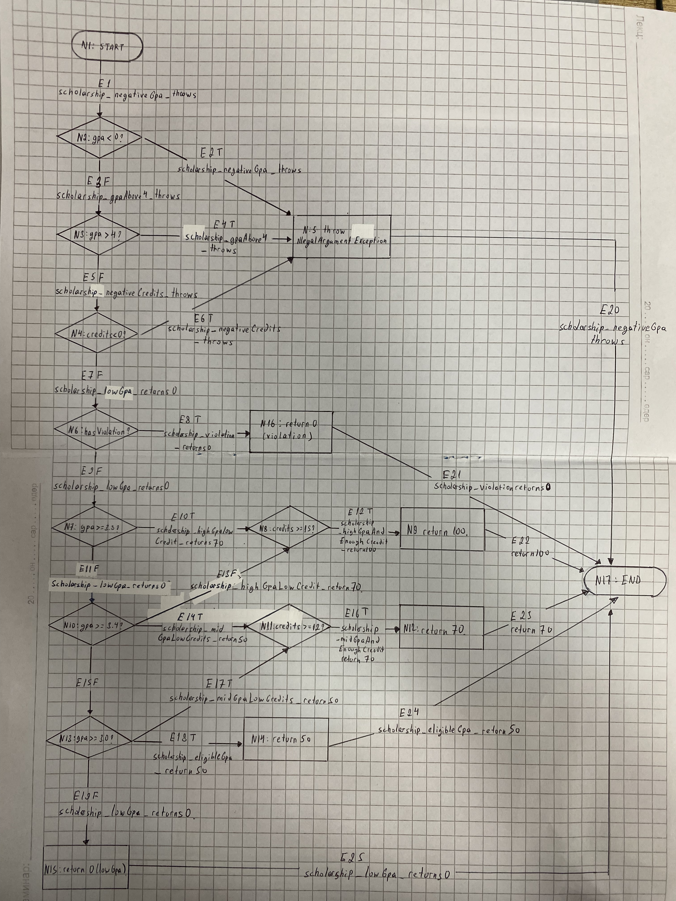

# Лаборатори 9 — Код хамралт

С. Энхбаяр / B232270153 / F.CSA313

[](https://github.com/Bayraa12/F.CSA313_lab9/actions/workflows/test.yml)

## Орчин

WSL2 Ubuntu 24.04 дээр ажиллуулав.

`java -version`

```text
openjdk version "21.0.12.1" 2026-08-18
OpenJDK Runtime Environment (build 21.0.12.1+1-1-24.04.4-Ubuntu)
OpenJDK 64-Bit Server VM (build 21.0.12.1+1-1-24.04.4-Ubuntu, mixed mode, sharing)
```

`mvn -version`

```text
Apache Maven 3.8.7
Maven home: /usr/share/maven
Java version: 21.0.12.1, vendor: Ubuntu, runtime: /usr/lib/jvm/java-21-openjdk-amd64
Default locale: en, platform encoding: UTF-8
OS name: "linux", version: "6.6.87.2-microsoft-standard-wsl2", arch: "amd64", family: "unix"
```

Ажиллуулах: `mvn clean verify`. HTML тайлан: `target/site/jacoco/index.html`.

## Хамралтын үр дүн

| Үе шат | Тест | Line | Branch | Нотолгоо |
|---|---:|---:|---:|---|
| A | 5 | 64.00% | 53.66% | [Лог](results/mvn-verify-A.txt), [CSV](results/jacoco-A.csv) |
| B | 21 | 100.00% | 100.00% | [Лог](results/mvn-verify-B.txt), [CSV](results/jacoco-B.csv) |
| C | 24 | 100.00% | 100.00% | [Лог](results/mvn-verify-C.txt), [CSV](results/jacoco-C.csv) |
| D эцсийн | 31 | 100.00% | 100.00% | [Лог](results/mvn-verify-final.txt), [CSV](results/jacoco-final.csv) |

A-д хэвийн оролтуудыг шалгасан тул буруу оролтын exception, C/D/F дүнгийн замууд улаан үлдсэн.
Оролтын шалгалт болон тэтгэлгийн нөхцөлүүдийн зарим салаа ажиллаагүй тул шар ромботой байсан.
B-д exception, switch-ийн default, `&&` болон `||`-ийн дутуу замуудыг нөхөхөд 21 тест болсон.
B болон эцсийн CSV-д `LINE_MISSED=0`, `BRANCH_MISSED=0` байна.

Гараар зурсан [CFG](cfg1.png), мөн [draw.io дээр зурсан хувилбар](cfg.png).
Ирмэгүүдэд тэдгээрийг дайрах тестийн нэрийг тэмдэглэсэн.



## C давталтын зааг

- 0 элемент: хоосон массив, `null` оролтод `assertThrows`-оор exception шалгасан.
- 1 элемент: `[95] → 4.0`.
- 2+ элемент: `[95,85,75,65] → 2.5`.

B-д салаанууд аль хэдийн хамрагдсан тул эдгээр тест хамралтын хувийг нэмээгүй.
Гэхдээ нэг болон олон дүнгийн голч зөв бодогдох, өгөгдөлгүй оролтыг зөв татгалзахыг тусад нь шалгасан.

## D зааг утгын алдаа

`letterGrade_boundaryScores_matchesSpecification(double, String)[1]` тестэд `60` оноо өгөхөд унасан.
[Засварын өмнөх лог](results/mvn-test-D-fail.txt):

```text
expected: <D> but was: <F>
Tests run: 31, Failures: 1, Errors: 0, Skipped: 0
```

`score > 60`-ыг `score >= 60` болгож [d602117 commit](https://github.com/Bayraa12/F.CSA313_lab9/commit/d60211732d2b519812651b8e7b427d5ada20d649)-д зассан.

B шатанд хамралт 100% болсон ч яг 60 оноог шалгасан тест байгаагүй.
`> 60` ба `>= 60` нь ижил тооны салаатай тул хамралтын хувь алдааг ялгаагүй.
60 онооны тест нэмэхэд D хүлээсэн боловч F буцаж байгааг илрүүлсэн.
Хамралт нь кодын ямар мөр, салаа ажилласныг хэмждэг бөгөөд хариу нь зөв эсэхийг дангаараа батлахгүй.
Тиймээс спецификацийн зааг утгыг шалгаж, засварын дараа 31 тест бүгд ногоон болсныг баталсан.

## Coverage gate ба CI

Branch хамралт 90%-иас доош бол `mvn verify` унана.
[Gate-ийн шалгалтад](results/mvn-verify-gate-fail.txt) A-ийн 5 тест ногоон байсан ч хамралт 53.66% тул build унасан.
GitHub Actions push болон pull request бүрд `mvn clean verify` ажиллуулна.
